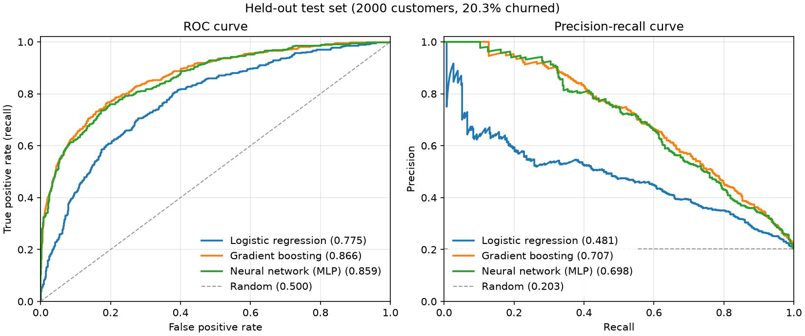

# Bank customer churn prediction

[](https://github.com/MSJawad/ANeuralNet-Bank-Solutions/actions/workflows/ci.yml)

Predicts which customers of a bank are about to close their accounts, from a 10,000-row tabular
dataset. Two simple baselines (logistic regression and gradient boosting, in scikit-learn) are
compared against a small PyTorch neural network, using the same preprocessing pipeline, a
stratified held-out test set, and metrics that suit a 20% minority class (ROC-AUC and PR-AUC).
It comes with a command line tool to train, evaluate and score new customers, plus tests and CI.



## Results

Held-out test set: 2,000 customers (20% of the data), of whom 407 (20.3%) churned. The test
set is used only for this table: models are fitted on the training split, and each decision
threshold is chosen on a separate validation split.

How well each model ranks customers by churn risk, independent of any threshold. A random
ranking scores ROC-AUC 0.5 and PR-AUC 0.203 (the churn rate). The intervals are 95% bootstrap
confidence intervals over the test rows (1,000 stratified resamples).

| Model | ROC-AUC | 95% CI | PR-AUC | 95% CI |
|---|---|---|---|---|
| Logistic regression | 0.775 | 0.749-0.801 | 0.481 | 0.438-0.528 |
| Gradient boosting | 0.866 | 0.846-0.886 | 0.707 | 0.670-0.744 |
| Neural network (MLP) | 0.859 | 0.838-0.880 | 0.698 | 0.659-0.737 |

The decisions each model makes at its chosen threshold (see
[Decision threshold](#decision-threshold)). Predicting that nobody churns scores accuracy 0.796.

| Model | Threshold | Precision | Recall | F1 | Accuracy |
|---|---|---|---|---|---|
| Logistic regression | 0.26 | 0.453 | 0.595 | 0.514 | 0.771 |
| Gradient boosting | 0.39 | 0.695 | 0.560 | 0.620 | 0.861 |
| Neural network (MLP) | 0.39 | 0.722 | 0.548 | 0.623 | 0.865 |

Produced with seed 42 on an Apple M1 laptop (CPU, Python 3.12, the versions in `uv.lock`) by:

```sh
uv run bank-churn train
uv run bank-churn evaluate --plot docs/curves.png
```

Training all three models takes well under a minute.

What the numbers say:

- **Gradient boosting and the neural network are tied.** Their scores differ by less than 0.01
  and their confidence intervals overlap almost completely. On a small tabular dataset like
  this, gradient-boosted trees are the stronger default: they match the network with no
  scaling, no tuning of epochs and a fraction of the code.
- **Logistic regression is clearly worse** (ROC-AUC 0.775). Churn depends on the inputs in ways
  a linear model can't express: it peaks for customers in their 50s (56% churned) and falls
  again after 60, and it's 8% for customers with two products but 83% with three.
- **Accuracy is misleading here.** 0.86 sounds high, but the do-nothing baseline already scores
  0.80. At its threshold, gradient boosting finds 56% of the customers who leave, and about 7
  in 10 of the customers it flags really do leave.
- These results come from one dataset that is widely described as synthetic (see
  [Dataset](#dataset)), so treat them as a demonstration of the method, not as evidence about
  real banks.

## How it works

### Features

The model uses the ten customer attributes: credit score, country, gender, age,
tenure, balance, number of products, has a credit card, is an active member, and estimated
salary. The identifier columns `RowNumber`, `CustomerId` and `Surname` are dropped. They say
nothing about how a customer behaves, so a model could only use them to memorise individual
rows (surnames) or to pick up quirks of how the file was ordered (row numbers and IDs), and
neither would carry over to new customers.

### Preprocessing

One scikit-learn `ColumnTransformer`, shared by all three models: numeric
columns are standardised, country and gender are one-hot encoded, and the two 0/1 flags pass
through unchanged. It's fitted on the training split only, so nothing about the validation or
test rows leaks into it. A country never seen in training encodes as all zeros instead of
crashing.

### Splits

The data is split once, stratified on the churn label so every part keeps the 20%
churn rate: 20% held out as the test set, then 20% of the rest as the validation set
(1,600 rows), leaving 6,400 rows for training. The split is fixed by the seed, and `evaluate`
rebuilds it from the seed saved with each model.

### Models

- Logistic regression (`LogisticRegression`, default regularisation).
- Gradient boosting (`HistGradientBoostingClassifier`, learning rate 0.05, up to 500 trees with
  early stopping on an internal 10% split).
- Neural network: a PyTorch multilayer perceptron, 13 inputs, hidden layers of 32 and 16 ReLU
  units with 10% dropout, one output logit. It's trained with Adam (learning rate 0.001, weight
  decay 0.0001) on binary cross-entropy in batches of 64, and stops after 15 epochs without
  improvement on a 15% early-stopping split of the training rows, keeping the best weights.

### Class imbalance

Only one customer in five churns. The project handles that by stratifying
every split, by reporting PR-AUC next to the base rate (PR-AUC measures how well the churners
are found and, unlike ROC-AUC, gets harder as they get rarer), and by choosing the decision
threshold explicitly instead of using 0.5. The models are trained without class weights. A one-off check
on the validation split (not part of the CLI) found that `class_weight="balanced"` didn't
improve the ranking (ROC-AUC 0.757 to 0.762 for logistic regression, 0.865 to 0.860 for
gradient boosting) and pushed the average predicted probability from 0.20 to about 0.4, so the
outputs would no longer read as churn probabilities.

### Decision threshold

A customer is predicted to churn when their churn probability is at or
above the model's threshold. Each model's threshold is the one that maximises F1 for the churn
class on the validation split, which balances catching churners (recall) against flagging
customers who would have stayed (precision). With a 20% base rate, a 0.5 cut-off flags too few
customers. The thresholds come out at 0.26 to 0.39. If missing a churner costs more than a
wasted retention offer, pass a lower `--threshold` to `predict`.

### Why PyTorch

The original project used Keras with the TensorFlow backend. PyTorch is used
here because it's the mainstream deep learning library today and installs as one wheel with no
separate backend. The network is wrapped as a scikit-learn estimator, so it slots into the same
pipeline as the baselines. Training runs on the CPU because the data is tiny (the CPU is faster
than a GPU or Apple's MPS here) and CPU runs repeat exactly with the same seed.

## Quick start

You need [uv](https://docs.astral.sh/uv/) and Python 3.12 (uv installs Python for you if it's
missing).

```sh
git clone https://github.com/MSJawad/ANeuralNet-Bank-Solutions.git
cd ANeuralNet-Bank-Solutions
uv sync
uv run bank-churn train      # fits all three models and saves them in models/
uv run bank-churn evaluate   # prints the results tables above
```

Without uv, `python3.12 -m venv .venv && .venv/bin/pip install -e .` also works (on Linux, add
`--extra-index-url https://download.pytorch.org/whl/cpu` to skip the large CUDA build of
PyTorch). The versions in `pyproject.toml` are pinned, but only uv uses the full lock file.

## Command line

```text
bank-churn train     [--data CSV] [--model logreg|gboost|mlp|all] [--out-dir DIR] [--seed N]
                     [--max-epochs N]
bank-churn evaluate  [MODEL ...] [--data CSV] [--bootstrap N] [--plot PNG] [--json FILE]
bank-churn predict   --model MODEL --input CSV [--output CSV] [--threshold P]
```

`train` saves one file per model (`models/logreg.joblib` and so on), holding the fitted pipeline,
its threshold, the seed, a SHA-256 of the training file and the library versions. `evaluate`
refuses to run against a different data file, because the test split only means something for
the file the model was trained on.

`predict` reads any CSV with the ten feature columns and appends `churn_probability` and
`churn_predicted`. Extra columns such as IDs are kept in the output but ignored by the model, and
a file with a blank feature value in any row is rejected rather than scored:

```sh
uv run bank-churn predict --model models/gboost.joblib --input examples/customers.csv
```

```text
CreditScore,Geography,Gender,Age,Tenure,Balance,NumOfProducts,HasCrCard,IsActiveMember,EstimatedSalary,churn_probability,churn_predicted
600,France,Male,40,3,60000,2,1,1,50000,0.0964,0
650,Germany,Female,52,4,120000,1,1,0,90000,0.7843,1
720,Spain,Female,29,6,0,2,0,1,40000,0.0282,0
```

The first row is the example customer from the original course exercise.

Saved models are Python pickles (joblib), which can run code when loaded. Only load models you
trained yourself.

## Dataset

`data/churn_modelling.csv` is the "Churn Modelling" dataset that SuperDataScience distributes
with its deep learning course and that has been re-shared widely since, for example
[on Kaggle](https://www.kaggle.com/datasets/shrutimechlearn/churn-modelling) and
[on OpenML](https://www.openml.org/d/45062). It has 10,000 customers of a fictional European
bank in France, Germany and Spain, 13 columns plus the `Exited` label (1 = closed their account),
and no missing values. It is widely described as synthetic: the customers are not real people.

No original licence for the file has been published (Kaggle lists it as "Unknown"), so it is kept
in the repository as it was in the original course project rather than fetched from a third-party
mirror. SHA-256: `ee2a5c9d8daf3aed0d91c4d883a84ebb77d271447bebc0f0c80aafb0f288ceab`.

## Project layout

```text
src/bank_churn/
  data.py         loading, column checks, stratified splits
  models.py       shared preprocessing and the three model pipelines
  nn.py           PyTorch network, training loop, scikit-learn wrapper
  metrics.py      ROC-AUC, PR-AUC, threshold choice, bootstrap intervals
  experiment.py   train / evaluate / predict logic and the curves plot
  cli.py          the bank-churn command
tests/            unit and CLI tests on small synthetic data (no dataset or GPU needed)
data/             the dataset
examples/         sample input for predict
docs/curves.png   the figure above
```

## Development

```sh
uv run pytest               # about 20 seconds
uv run ruff check && uv run ruff format --check
```

CI runs the same lint and tests on pushes to master and on pull requests.

## History

This started in 2018 as homework for a Udemy neural networks course: the churn modelling
exercise that SuperDataScience publishes with its "Deep Learning A-Z" course, built as a Keras
and scikit-learn script. That
script no longer ran on current versions of either library. In 2026 it was replaced by this
package, which keeps the same problem and dataset but adds baselines, a held-out evaluation,
and tests. The original script is in the git history.

## Author

Solaiman Jawad
